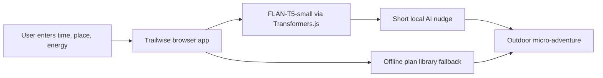

*This is a submission for the [Hacktoberfest Open-Source AI Challenge Week 1: Touch Grass](https://dev.to/challenges/hacktoberfest-week1-2026-10-05)*

## What I Built

Trailwise is a local-first micro-adventure planner that helps people spend less time deciding what to do and more time outside.

The user enters a location, available time, energy level, and preferred mood. Trailwise creates a small outdoor activity that can begin immediately: a quiet noticing walk, a body-moving route, a found-object creative activity, or a simple social walk.

It is designed for students, remote workers, families, and anyone who wants to go outside but feels stuck planning the perfect outing. The screen is only used to create the plan; the actual experience happens outdoors.

## Demo

Live demo: **Add your Render URL here**

The app is deployed as a static site on Render.

## Code

GitHub repository: **Add your GitHub repository URL here**

## How I Built It

Trailwise is built with HTML, CSS, and JavaScript. The interface is hosted as a static site, so it does not need a backend or database.

The AI layer uses `Xenova/flan-t5-small`, an open-weight model, through [Transformers.js](https://github.com/huggingface/transformers.js). The model runs directly in the user's browser and generates a short, friendly introduction for the outdoor plan.

The app also includes a small deterministic plan library. This keeps the core experience useful while the model is downloading and gives lower-powered devices a reliable fallback.

Architecture:

## Why Does Open Innovation Matter?

An outdoor app can handle sensitive information. A location prompt may reveal where someone lives, walks, or spends time. Trailwise keeps that prompt in the browser instead of sending it to a closed AI API.

Using an open-weight model also makes the project changeable. Developers can inspect the prompt, replace the model, improve the plan library, or run the project without an API key. Render only hosts the static files; the AI inference happens in the user's browser.

This approach also keeps the cost low and makes the project portable. The tradeoff is that the first model download can take time and browser performance varies. That is why Trailwise includes a deterministic fallback instead of pretending every device has the same hardware.

## My Agent Session

Optional DevRelay session: **Add your DevRelay agent session link here**

## Prize Categories

### Best Use of Render

Trailwise is deployed as a Render static site and automatically redeploys when the connected GitHub branch changes. Render provides the public demo while the open-weight model runs in the browser.

## What I Learned Outside

After deploying Trailwise, I will take one of its micro-adventures outdoors and add what happened here: where I went, which plan I tried, and one detail I noticed because I was no longer looking at a screen.

<!-- Team Submissions: Add teammates' DEV usernames here if applicable. -->
